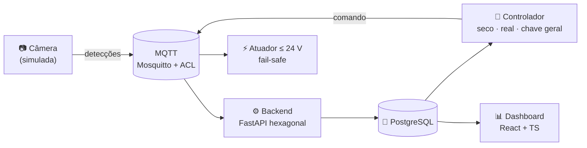

<!-- ===================== HEADER ===================== -->
<a id="topo"></a>
<p align="center">
  
</p>

<p align="center">
  
</p>

<p align="center">
  <a href="https://www.linkedin.com/in/adslustosa/"></a>
  <a href="mailto:adslustosa@gmail.com"></a>
  <a href="https://www.dio.me/users/asdlustosa"></a>
  
  
</p>


## 👨‍💻 Sobre mim

Profissional de TI que transita entre **três frentes que se complementam**: construo interfaces e sistemas, mantenho a infraestrutura que os sustenta e estudo como protegê-los. Foi essa vivência prática — não só teórica — que me mostrou que boa parte dos riscos de segurança nasce de decisões tomadas (ou negligenciadas) no desenvolvimento e na infraestrutura.

```ts
const joaoPedro = {
  hoje: [
    "Coordenador de TI @ NEW LAV",
    "Dev Web freelance (React + TS)",
  ],
  construindo: [
    "Pigeondome — IoT de ponta a ponta",
    "Laboratório de Purple Team",
  ],
  estudando: [
    "Pós em Segurança da Informação",
    "Pós em Direito Digital e LGPD",
  ],
  buscando: [
    "Back-end / Full-stack",
    "Análise de Sistemas",
    "Segurança, GRC e Proteção de Dados",
  ],
};
```

<table>
  <tr>
    <td align="center" valign="top" width="33%">
      <h3>🖥️ Infra & Sistemas</h3>
      ERP industrial, redes corporativas (MikroTik, switches, CFTV), servidores e planejamento de hardware junto ao financeiro.
    </td>
    <td align="center" valign="top" width="33%">
      <h3>⚛️ Desenvolvimento</h3>
      Front-end com React e TypeScript; back-end em Python com FastAPI, PostgreSQL e arquitetura hexagonal.
    </td>
    <td align="center" valign="top" width="33%">
      <h3>🛡️ Segurança & GRC</h3>
      Purple Team na prática, segurança por padrão nos projetos e conformidade com a LGPD.
    </td>
  </tr>
</table>


## 🛠️ Stack

<table>
  <tr>
    <td align="center" width="50%" valign="top">
      <b>🎨 Front-end</b><br><br>
      
    </td>
    <td align="center" width="50%" valign="top">
      <b>⚙️ Back-end & Dados</b><br><br>
      
    </td>
  </tr>
  <tr>
    <td align="center" width="50%" valign="top">
      <b>🚢 DevOps & Qualidade</b><br><br>
      
    </td>
    <td align="center" width="50%" valign="top">
      <b>📡 IoT & Segurança</b><br><br>
      
    </td>
  </tr>
</table>

<p align="center">
  
  
  
  
  
  
  
  
  
  
  <br>
  
  
  
  
  
  
  
</p>


## 🚀 Projetos

<table>
  <tr>
    <td valign="top">
      <h3>🕊️ <a href="https://github.com/ADSLustosa/pigeondome">Pigeondome</a> <sub>· Controle Inteligente de Pombos</sub></h3>
      Sistema IoT de ponta a ponta: uma câmera (simulada) publica detecções via <b>MQTT</b>, um backend <b>FastAPI</b> em arquitetura hexagonal grava tudo no <b>PostgreSQL</b>, um controlador decide quando acionar o atuador de baixa tensão (≤ 24 V) com modo seco, chave geral e <b>fail-safe</b>, e um <b>dashboard React</b> mostra presença e decisões em tempo real.
      <br><br>
      
      
      
      
      
      
      
      
    </td>
  </tr>
</table>

<details>
<summary><b>🧭 Ver a arquitetura do Pigeondome</b></summary>
<br>



**Segurança desde o início:** ACL por papel no broker, secret scanning e push protection, branch protegida com 3 checks obrigatórios e erros padronizados em RFC 9457.

</details>

<table>
  <tr>
    <td width="50%" valign="top">
      <h3>🟣 <a href="https://github.com/ADSLustosa/purple-team-lab">purple-team-lab</a></h3>
      Laboratório prático de Purple Team: ataque, detecção e documentação de cada exercício.
      <br><br>
      
      
    </td>
    <td width="50%" valign="top">
      <h3>📡 <a href="https://github.com/ADSLustosa/Objetos-Inteligentes-Conectados">Objetos Inteligentes</a></h3>
      Projeto IoT da disciplina Objetos Inteligentes Conectados (ADS — Mackenzie).
      <br><br>
      
      
    </td>
  </tr>
  <tr>
    <td colspan="2" valign="top">
      <h3>🔧 Gestão para Oficinas <sub>· em construção</sub></h3>
      Sistema de gestão para oficinas mecânicas, desenvolvido do zero.
    </td>
  </tr>
</table>


## 💼 Trajetória

<details open>
<summary><b>🏭 Coordenador de TI</b> — NEW LAV · <i>set/2025 – atual</i> · Fortaleza-CE</summary>
<br>

- Coordenação da implantação e do suporte ao **ERP industrial**, com resolução de incidentes críticos nas operações de produção
- Planejamento e condução de **treinamentos de usuários** para adoção correta da plataforma
- Gestão da infraestrutura: manutenção preventiva e corretiva de computadores, servidores e equipamentos
- Administração de redes corporativas: **MikroTik**, roteadores, switches e **CFTV/DVR**
- Análise técnica de equipamentos e definição de prioridades de reparo, substituição ou upgrade por criticidade
- Requisições de compra com avaliação de custo-benefício, prazos e fornecedores
- Interface entre TI e produção, traduzindo necessidades técnicas em soluções de negócio

> **Resultados:** ⏱️ menor tempo médio de resolução de incidentes críticos · 📶 rede e infraestrutura mais disponíveis e confiáveis · 💰 compras que equilibram custo e continuidade operacional

</details>

<details>
<summary><b>⚛️ Desenvolvedor Web</b> — Freelance · <i>mar/2025 – atual</i> · Remoto</summary>
<br>

- Interfaces com **React** e **TypeScript**, priorizando componentização, reutilização e boas práticas de arquitetura front-end
- Funcionalidades em JavaScript com foco em interatividade, performance e integração com APIs
- HTML semântico e CSS responsivo, com compatibilidade entre dispositivos e navegadores
- Integração de canais digitais (WhatsApp Business, Facebook, Instagram) e padronização de conteúdo
- Atuação em time coordenado por um desenvolvedor Full Stack, participando de definições técnicas e alinhamento de entregas

</details>

<details>
<summary><b>🏥 Técnico de TI</b> — Hospital Proclinicas Santa Maria · <i>mai/2025 – ago/2025</i> · Juazeiro do Norte-CE</summary>
<br>

- Administração e suporte ao software de gestão hospitalar
- Atendimento de 1º e 2º nível aos usuários
- Montagem, manutenção e análise de equipamentos para aquisição e instalação

</details>


## 🎓 Formação

| Curso | Instituição | Período |
|:--|:--|:--:|
| 🛡️ Pós-graduação em Segurança da Informação | Gran Faculdade |  |
| ⚖️ Pós-graduação em Direito Digital e Proteção de Dados | Gran Faculdade |  |
| 💻 Tecnólogo em Análise e Desenvolvimento de Sistemas | Universidade Presbiteriana Mackenzie |  |

<details>
<summary><b>📜 Cursos e Bootcamps</b></summary>
<br>

- 🐍 Python Fundamentals — DIO
- 🐧 Linux Fundamentals — DIO
- 🧠 Programação Lógica — DIO
- ☁️ Bootcamp NEXA — Machine Learning para Iniciantes (AWS), Fundamentos de IAs Generativas e Claude
- 🤖 Bootcamp Santander 2024 — Fundamentos de IA para Devs

</details>

<details>
<summary><b>✍️ Publicações</b></summary>
<br>

- 📰 [PIRATAS DA TECNOLOGIA: Navegando em IAs misteriosas](https://www.dio.me/articles/piratas-da-tecnologia-navegando-em-ias-misteriosas) — DIO

</details>


## 📊 GitHub em números

<p align="center">
  
  
</p>
<p align="center">
  
  
</p>


<p align="center">
  <i>🔐 Entendo como sistemas são construídos, como a infraestrutura que os sustenta funciona e onde nascem as vulnerabilidades quando isso não é bem gerido.</i>
  <br><br>
  <a href="#topo"></a>
</p>

<p align="center">
  
</p>
